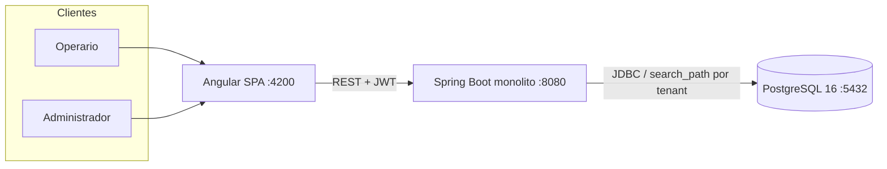
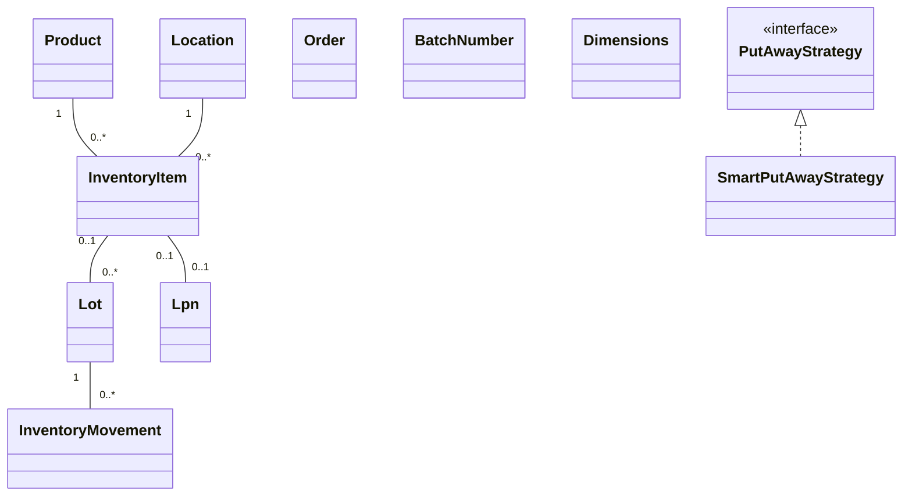

# Arquitectura — WMS

> **Revisado el 2026-10-21 contra el código** (rama `dev` @ `813be57`). Cada afirmación es
> verificable o está marcada como "no verificado". El estado global del sistema está en
> [`docs/CURRENT_STATE.md`](CURRENT_STATE.md); la fuente de verdad de las features en curso
> está en `odd/tasks/`.

---

## 1. Visión del producto

WMS es un **monolito modular** (no microservicios) para gestión de almacenes: catálogo de
productos, ubicaciones, inventario, órdenes con flujo de estados, picking, dashboard de KPIs,
cadena de frío y multi-tenant SaaS por schema. Backend Spring Boot + frontend Angular,
arquitectura hexagonal (Ports & Adapters) organizada por **contextos acotónicos**.

### 1.1 Glosario (lenguaje ubicuo)

- **SKU:** identificador único de un producto.
- **LPN (License Plate Number):** identificador único de un contenedor (pallet/caja) que agrupa
  inventario; VO con validación de formato (`Lpn.java`).
- **Bin / Ubicación:** ubicación física dentro del almacén (`Location`).
- **Picking:** recolección de mercancía para una orden (sesiones gestionadas por
  `inventory/application/service/PickingService.java`).
- **Put-away:** ubicación estratégica de mercancía recibida
  (`inventory/domain/strategy/PutAwayStrategy.java` + `SmartPutAwayStrategy`).
- **Tenant:** empresa cliente; sus datos viven en un schema PostgreSQL propio (`tenant_{id}`).

---

## 2. Topología real de ejecución

Un solo proceso backend atiende todos los contextos. **No hay** API Gateway, message broker
ni servicios separados.

```
┌──────────────────────────┐
│  Angular (:4200, nginx)  │  wms-frontend/ (en contenedor)
└────────────┬─────────────┘
             │ REST/JSON + JWT
             ▼
┌──────────────────────────────────────────────┐
│  Spring Boot (:8080) — UN proceso, 8 paquetes │
│  audit · catalog · identity · inventory ·     │
│  monitoring · orders · warehouse · shared     │
│  (picking ∈ inventory · SaaS ∈ identity ·     │
│   dashboard ∈ shared/api)                     │
└────────────┬─────────────────────────────────┘
             │ JDBC (HikariCP + TenantAwareDataSource)
             ▼
┌──────────────────────────────────────────────┐
│  PostgreSQL 16 (wms_db)                       │
│  schema public + schemas tenant_* por empresa │
│  Flyway: V1 (tenant_schemas) + V2 (tablas)    │
└──────────────────────────────────────────────┘
```



---

## 3. Arquitectura interna

### 3.1 Hexagonal por contexto

Cada contexto (`catalog`, `orders`, `inventory`, …) sigue:

- `domain/` — entidades, value objects, puertos (interfaces) y estrategias. Java puro.
- `application/` — casos de uso y servicios (`<x>/application/service/`).
- `infrastructure/in/rest/` — controllers REST (adaptadores de entrada).
- `infrastructure/out/persistence/` — repositorios JPA/Spring Data (adaptadores de salida).

**Advertencia de madurez:** el nombre de una clase no garantiza su comportamiento.
`LotJpaAdapter` y `MovementJpaAdapter` viven en `out/persistence` pero **no son JPA**:
son `HashMap` en memoria (ver `docs/CURRENT_STATE.md` §5 — pendiente de la feature B).

### 3.2 Multi-tenant por schema (estado post feature A)

Decisión de diseño: **un schema PostgreSQL por tenant** (`tenant_{tenantId}`), implementado el
2026-10-21 (PR #44, `odd/tasks/tenant-isolation-and-schema.md`):

- `shared/infrastructure/tenant/TenantAwareDataSource.java` — wrapper del DataSource de
  HikariCP que fija `search_path` en **cada checkout de conexión** según el `TenantContext`
  (claim `tenantId` del JWT). **Fail-closed**: si el schema no existe → error, nunca datos de
  `public`.
- `shared/infrastructure/tenant/TenantSchemaManager.java` — provisioning de schemas.
- `shared/infrastructure/tenant/TenantIsolationHealthIndicator.java` — `/actuator/health`
  reporta `tenantIsolation: UP (schema-based fail-closed)` o `DOWN`; nunca inventa estado.
- Config: `wms.tenant.isolation.enabled` (default `true`; el perfil `dev` lo fuerza a `false`
  local; se puede forzar con `WMS_TENANT_ISOLATION_ENABLED`).

**No implementado (decisión documentada S7):** PostgreSQL RLS. Los archivos SQL
`V__enable_rls_*.sql`, `SearchPathConnectionInterceptor` e `SchemaIsolationValidator`
fueron **eliminados** por la feature A. Si otro documento los menciona como vigentes, está desactualizado.

### 3.3 Eventos de dominio

Eventos en memoria y en el mismo proceso (`@Async` + `ContextAwareTaskDecorator`, puente
`InventoryEventBridge`). **No hay RabbitMQ/Kafka**: la entrega es eventualmente consistente y
se pierde si el proceso cae. La persistencia de eventos está parcialmente deshabilitada
(`EventPersistenceIntegrationTest` tiene 1 test `@Disabled`).

---

## 4. Stack verificado (2026-10-21)

| Capa | Tecnología | Evidencia |
|------|-----------|-----------|
| Lenguaje | Java 21 (Temurin) | `pom.xml` |
| Framework | Spring Boot **3.4.1** | banner de arranque, 2026-10-21 |
| Build | Maven Wrapper | `mvnw.cmd` |
| BD | PostgreSQL 16 + Flyway 10 | `docker-compose.yml`, log de Flyway |
| API docs | springdoc (Swagger UI) | `pom.xml`; UI en `/swagger-ui.html` |
| Auth | JWT propio (`JwtService`) — **no** es un servidor OAuth2 | `shared/infrastructure/security/JwtService.java` |
| Aislamiento | Schema-based, fail-closed | §3.2 |
| Tests | JUnit 5 + Testcontainers (PostgreSQL real) | `src/test/` — 317 tests verdes |
| Frontend | Angular ^20 | `wms-frontend/package.json` |
| E2E | Playwright (API + UI) | `e2e/` (requiere `npm install`) |

**NO está en el stack** (aunque docs viejos lo afirman): microservicios, API Gateway,
RabbitMQ/Kafka, OAuth2 server, virtual threads (sin `spring.threads.virtual.enabled` en
ningún `application*.properties`), GraalVM native, RLS, JaCoCo, Helm charts.

### 4.1 Requerimientos no funcionales

No hay presupuestos de performance **medidos** (sin benchmarks, sin JaCoCo). Las metas de
latencia que aparezcan en documentos históricos no están verificadas.

---

## 5. Dominio (core)

Entidades y VOs **verificados en código** (rutas bajo `src/main/java/com/juanbenevento/wms/`):



Notas:

- `Order` tiene flujo de estados probado (crear → confirmar → pick → pack → ship → deliver).
- `Lot` e `InventoryMovement` existen como dominio, pero sus adapters **no persisten** (§3.1).
- No existe `PickingTask` ni `FEFOStrategy`: el picking vive en `PickingService` y el
  put-away usa `SmartPutAwayStrategy` (única implementación), inyectado en
  `warehouse/application/service/LocationSuggestionService.java`.

---

## 6. Decisiones de arquitectura (ADR)

### ADR-001: Product master separado de InventoryItem

- **Contexto:** gestionar instancias físicas (LPN, estados) sin duplicar metadata del producto.
- **Decisión:** `Product` (metadata) vs `InventoryItem` (instancia física).
- **Consecuencia:** joins más complejos; flexibilidad total de almacén.
- **Estado:** vigente; ambas clases existen en `catalog/domain` e `inventory/domain`.

### ADR-002: Value Objects para Lpn y BatchNumber

- **Decisión:** VOs inmutables con validación en dominio (`Lpn.java`, `BatchNumber.java`) en
  vez de strings crudos; convertidores JPA para persistencia.
- **Estado:** vigente; reglas exactas de formato en el código.

### ADR-003: Verbos HTTP estándar en la API

- **Decisión:** endpoints predecibles (`POST /receive`, `/put-away`, `/move`, …) en lugar de
  verbos arbitrarios (`create`, `save`, `add`).
- **Estado:** vigente; las bases de ruta de cada controller están en el `README.md` §API.

### ADR-004: Aislamiento multi-tenant por schema (RLS diferido)

- **Contexto:** el soft multi-tenancy (columna `tenant_id` + Hibernate filter) no aísla a
  nivel de base de datos: un DBA o backup comprometido ve datos de todas las empresas.
- **Decisión original (2026-04):** schema por tenant + RLS como capa extra.
- **Implementación real (2026-10-21, feature A):** schema-based con wrapper de DataSource
  fail-closed (§3.2). **RLS NO está implementado** — se diferenció (decisión S7) y sus
  archivos fueron eliminados para que el estado sea honesto. `V__enable_rls_*.sql`,
  `SearchPathConnectionInterceptor` e `SchemaIsolationValidator` **ya no existen**.
- **Estado:** ✅ aislamiento por schema implementado y verificado en vivo (suite 317/0/0/2,
  health indicator UP); ⏳ RLS y migración de datos a producción, pendientes.
- **Consecuencias:** backups/restores deben contemplar múltiples schemas; los usuarios de BD
  solo deben tener `USAGE` sobre su schema en producción; habilitar/deshabilitar el aislamiento
  es explícito (`WMS_TENANT_ISOLATION_ENABLED`).

---

## 7. Deuda estructural conocida

Ver `docs/CURRENT_STATE.md` §5 para la lista completa con evidencia. Las tres más
estruturales:

1. Adaptadores "Jpa" en memoria (lotes/movements) y picking/cold-chain en `ConcurrentHashMap`.
2. CI que no corre en PRs hacia `dev` y despliegues (prod-compose, k8s) no utilizables.
3. Sin medición de cobertura ni de performance.
